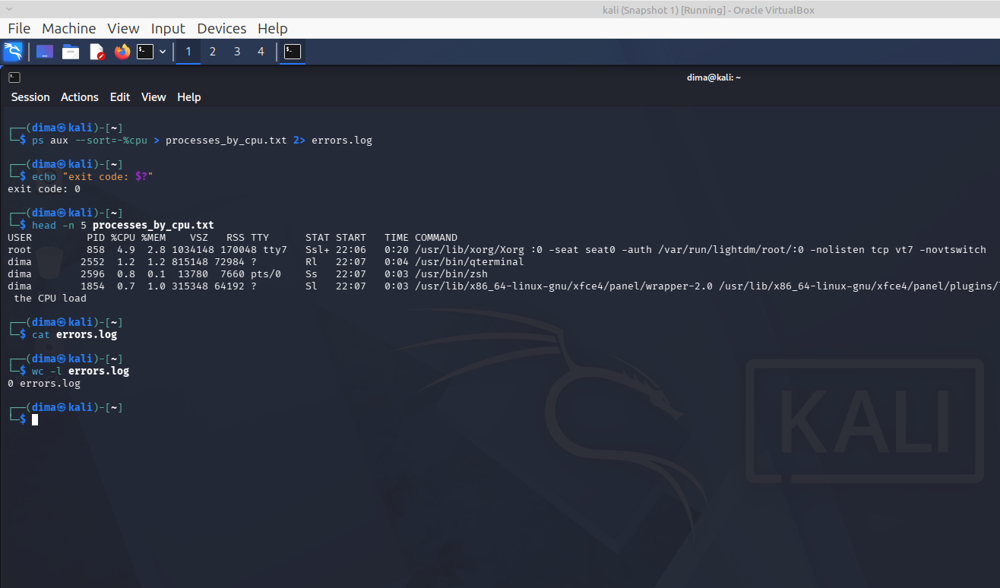
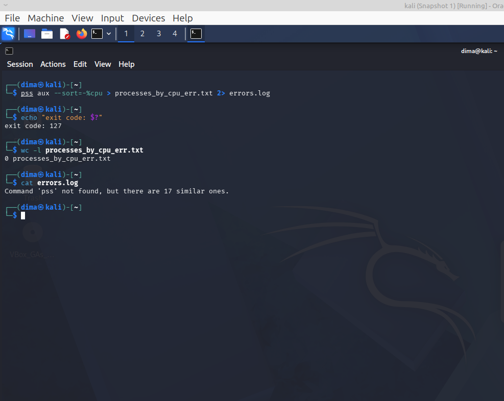

[На главную](../README.md)

---------
### Задание 1

**Сформировать команду, которая выводит список процессов, сортирует по CPU, сохраняет результат в файл, ошибки не попадают в файл. Отдельно продемонстрировать работу с ошибкой (например, неправильно написать в команде утилиту, которая выводит список процессов) и корректную работу**.

---------

### Итоговая команда
```bash
ps aux --sort=-%cpu > processes_by_cpu.txt 2> errors.log
```
### Демонстрация: корректная работа
```bash
──(dima㉿kali)-[~]
└─$ ps aux --sort=-%cpu > processes_by_cpu.txt 2> errors.log
                                                                                                                                                                                                                                            
┌──(dima㉿kali)-[~]
└─$ echo "exit code: $?"                                                                                                                                                                         
exit code: 0
                                                                                                                                                                                                                                            
┌──(dima㉿kali)-[~]
└─$ head -n 5 processes_by_cpu.txt
USER         PID %CPU %MEM    VSZ   RSS TTY      STAT START   TIME COMMAND
root         858  5.0  2.8 1034148 170048 tty7   Ssl+ 22:06   0:06 /usr/lib/xorg/Xorg :0 -seat seat0 -auth /var/run/lightdm/root/:0 -nolisten tcp vt7 -novtswitch
dima        2596  1.0  0.1  10344  6480 pts/0    Ss   22:07   0:01 /usr/bin/zsh
dima        2552  1.0  1.1 814324 72384 ?        Sl   22:07   0:01 /usr/bin/qterminal
dima        1753  1.0  2.3 1881880 140152 ?      Sl   22:07   0:01 xfwm4
                                                                                                                                                                                                                                            
┌──(dima㉿kali)-[~]
└─$ cat errors.log 
                                                                                                                                                                                                                                            
┌──(dima㉿kali)-[~]
└─$ wc -l errors.log 
0 errors.log
                                                                                                                                                                                                                                            
┌──(dima㉿kali)-[~]
└─$ 

```

### Демонстрация: работа с ошибкой
```bash
                                                                                                                                                                                                                                            
┌──(dima㉿kali)-[~]
└─$ pss aux --sort=-%cpu > processes_by_cpu_err.txt 2> errors.log
                                                                                                                                                                                                                                            
┌──(dima㉿kali)-[~]
└─$ echo "exit code: $?"
exit code: 127
                                                                                                                                                                                                                                            
┌──(dima㉿kali)-[~]
└─$ wc -l processes_by_cpu_err.txt
0 processes_by_cpu_err.txt
                                                                                                                                                                                                                                            
┌──(dima㉿kali)-[~]
└─$ cat errors.log
Command 'pss' not found, but there are 17 similar ones.
                                                                                                                                                                                                                                            
┌──(dima㉿kali)-[~]
└─$ 


```
### Корректная работа



### Работа с ошибкой



[На главную](../README.md)
