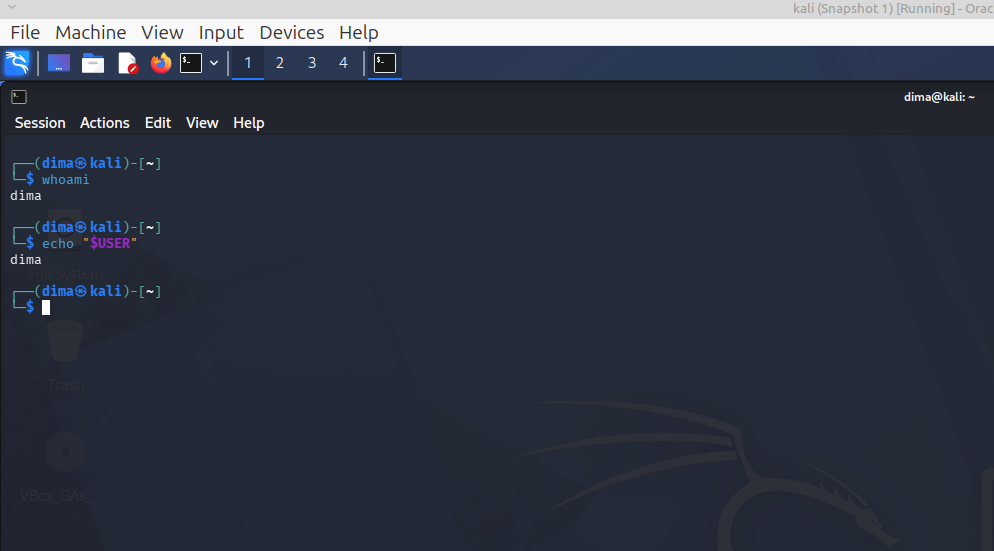
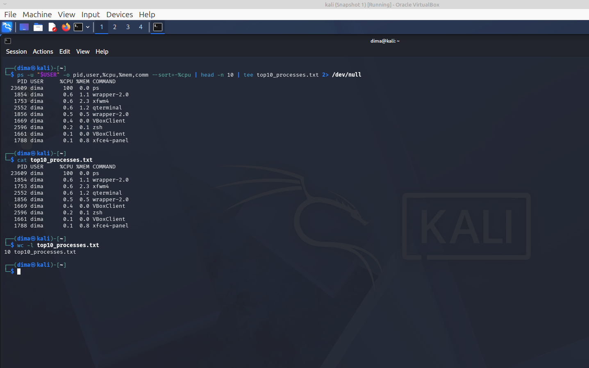

[На главную](../README.md)

---------
### Задание 2

**Написать команду, которая выводит топ 10 процессов от текущего пользователя и при этом выводит результат одновременно в терминал и в файл (запись в файл, а потом его чтение не считается)**.

---------

### Проверка пользователя
```bash
┌──(dima㉿kali)-[~]
└─$ whoami                        
dima
                                                                                                                                                                                                                                            
┌──(dima㉿kali)-[~]
└─$ echo "$USER"        
dima
                                                                                                                                                                                                                                            
┌──(dima㉿kali)-[~]
└─$ 

```

### Выполнение команды
```bash
                                                                                                                                                                                                                                            
┌──(dima㉿kali)-[~]
└─$ ps -u "$USER" -o pid,user,%cpu,%mem,comm --sort=-%cpu | head -n 10 | tee top10_processes.txt 2> /dev/null
    PID USER     %CPU %MEM COMMAND
  23609 dima      100  0.0 ps
   1854 dima      0.6  1.1 wrapper-2.0
   1753 dima      0.6  2.3 xfwm4
   2552 dima      0.6  1.2 qterminal
   1856 dima      0.5  0.5 wrapper-2.0
   1669 dima      0.4  0.0 VBoxClient
   2596 dima      0.2  0.1 zsh
   1661 dima      0.1  0.0 VBoxClient
   1788 dima      0.1  0.8 xfce4-panel
                                                                                                                                                                                                                                            
┌──(dima㉿kali)-[~]
└─$ 

```
### Проверка файла (после выполнения, отдельной командой)
```bash
┌──(dima㉿kali)-[~]
└─$ cat top10_processes.txt
    PID USER     %CPU %MEM COMMAND
  23609 dima      100  0.0 ps
   1854 dima      0.6  1.1 wrapper-2.0
   1753 dima      0.6  2.3 xfwm4
   2552 dima      0.6  1.2 qterminal
   1856 dima      0.5  0.5 wrapper-2.0
   1669 dima      0.4  0.0 VBoxClient
   2596 dima      0.2  0.1 zsh
   1661 dima      0.1  0.0 VBoxClient
   1788 dima      0.1  0.8 xfce4-panel
                                                                                                                                                                                                                                            
┌──(dima㉿kali)-[~]
└─$ 

```

### Проверка количества строк
```bash
┌──(dima㉿kali)-[~]
└─$ wc -l top10_processes.txt
10 top10_processes.txt
                                                                                                                                                                                                                                            
┌──(dima㉿kali)-[~]
└─$ 

```
### Скриншоты

### Проверка пользователя



### Выполнение команды




[На главную](../README.md)
