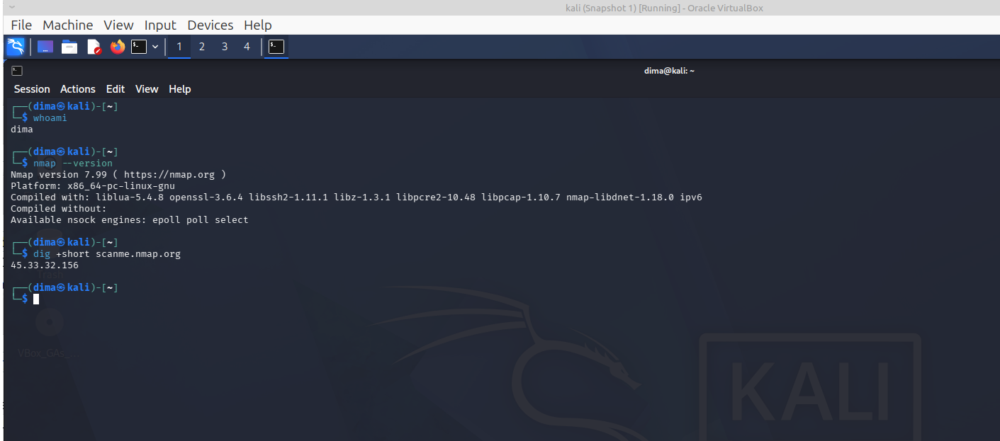
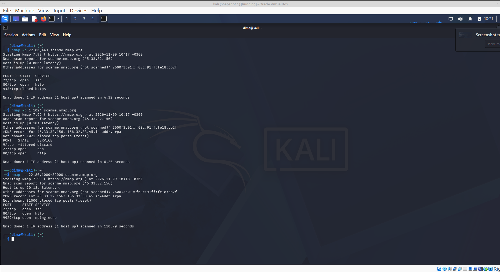
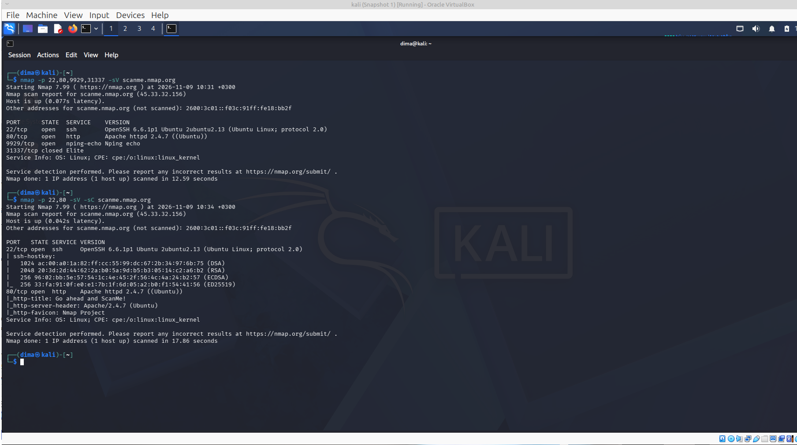
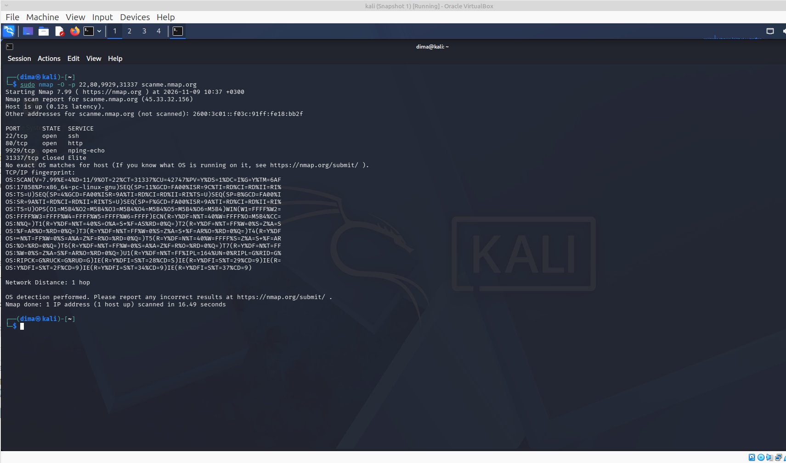
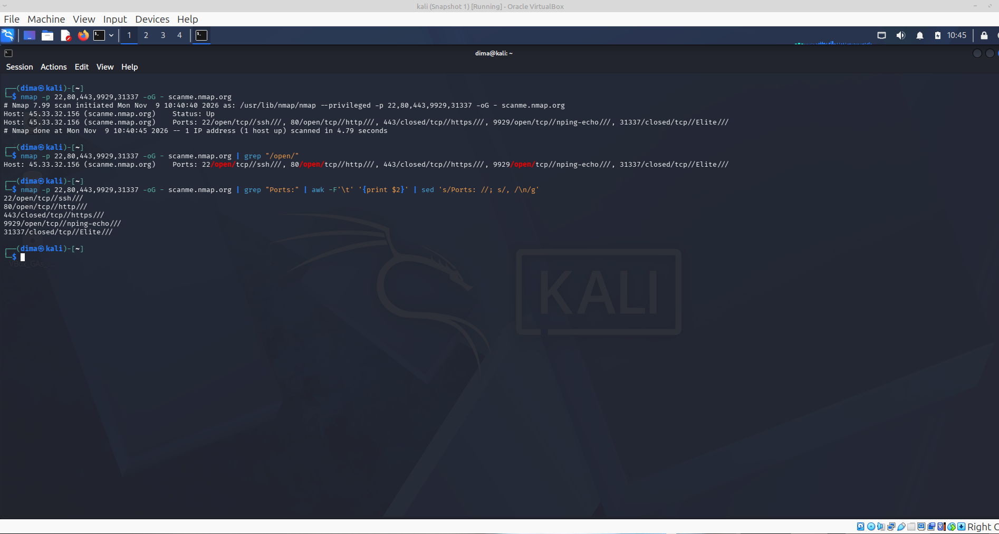

[На главную](../README.md)

---------
### Задание 3

**Просканировать ресурс scanme.nmap.org, проверить, какие порты открыты (задать порты разными способами: перечислением, диапазоном, и.т.п.), какие на них запущены сервисы, какая ОС установлена, а также отдельной командой просканировать только порты и вывести результат в grepable формате в Терминал (запись в файл, а потом его чтение не считается)**.

---------

### Подготовка окружения
```bash
──(dima㉿kali)-[~]
└─$ whoami                   
dima
                                                                                                                                                                                                                                            
┌──(dima㉿kali)-[~]
└─$ nmap --version
Nmap version 7.99 ( https://nmap.org )
Platform: x86_64-pc-linux-gnu
Compiled with: liblua-5.4.8 openssl-3.6.4 libssh2-1.11.1 libz-1.3.1 libpcre2-10.48 libpcap-1.10.7 nmap-libdnet-1.18.0 ipv6
Compiled without:
Available nsock engines: epoll poll select
                                                                                                                                                                                                                                            
┌──(dima㉿kali)-[~]
└─$ dig +short scanme.nmap.org
45.33.32.156
                                                                                                                                                                                                                                            
┌──(dima㉿kali)-[~]
└─$ 
                                                                                                                                                                                                                                            
```
### Способы задания портов в Nmap


| Способ | Пример | Что делает |
|--------|--------|-----------|
| Перечисление | `-p 22,80,443` | только перечисленные порты |
| Диапазон | `-p 1-1024` | все порты в диапазоне |
| Комбинация | `-p 22,80,1000-2000` | список + диапазон |
| По имени сервиса | `-p http,ssh,https` | порты, сопоставленные сервисам из `nmap-services` |
| Top-N популярных | `--top-ports 100` | 100 самых частых портов |
| Все порты TCP | `-p-` (= `-p 1-65535`) | полный обход TCP |
| Все порты UDP | `-p- -sU` | полный обход UDP (медленно!) |
| С исключением | `-p 1-1024 --exclude-ports 22` | диапазон без указанных портов |

### 1. Сканирование портов разными способами

### 1.1. Перечисление (-p 22,80,443)

```bash
┌──(dima㉿kali)-[~]
└─$ nmap -p 22,80,443 scanme.nmap.org
Starting Nmap 7.99 ( https://nmap.org ) at 2026-11-09 10:12 +0300
Nmap scan report for scanme.nmap.org (45.33.32.156)
Host is up (0.061s latency).
Other addresses for scanme.nmap.org (not scanned): 2600:3c01::f03c:91ff:fe18:bb2f

PORT    STATE  SERVICE
22/tcp  open   ssh
80/tcp  open   http
443/tcp closed https

Nmap done: 1 IP address (1 host up) scanned in 4.78 seconds
                                                                                                                                                                                                                                            
┌──(dima㉿kali)-[~]
└─$ 
```


### 1.2. Диапазон (-p 1-1024)

```bash
┌──(dima㉿kali)-[~]
└─$ nmap -p 1-1024 scanme.nmap.org 
Starting Nmap 7.99 ( https://nmap.org ) at 2026-11-09 10:17 +0300
Nmap scan report for scanme.nmap.org (45.33.32.156)
Host is up (0.18s latency).
Other addresses for scanme.nmap.org (not scanned): 2600:3c01::f03c:91ff:fe18:bb2f
rDNS record for 45.33.32.156: 156.32.33.45.in-addr.arpa
Not shown: 1021 closed tcp ports (reset)
PORT   STATE    SERVICE
9/tcp  filtered discard
22/tcp open     ssh
80/tcp open     http

Nmap done: 1 IP address (1 host up) scanned in 6.20 seconds
                                                                                                                                                                                                                                            
┌──(dima㉿kali)-[~]
└─$ 
```

### 1.3. Комбинация перечисления и диапазона (-p 22,80,1000-32000)

```bash
┌──(dima㉿kali)-[~]
└─$ nmap -p 22,80,1000-32000 scanme.nmap.org
Starting Nmap 7.99 ( https://nmap.org ) at 2026-11-09 10:18 +0300
Nmap scan report for scanme.nmap.org (45.33.32.156)
Host is up (0.18s latency).
Other addresses for scanme.nmap.org (not scanned): 2600:3c01::f03c:91ff:fe18:bb2f
rDNS record for 45.33.32.156: 156.32.33.45.in-addr.arpa
Not shown: 31000 closed tcp ports (reset)
PORT     STATE SERVICE
22/tcp   open  ssh
80/tcp   open  http
9929/tcp open  nping-echo

Nmap done: 1 IP address (1 host up) scanned in 110.79 seconds
                                                                                                                                                                                                                                            
┌──(dima㉿kali)-[~]
└─$ 
```

### 1.4. По именам сервисов (-p http,ssh,nping-echo)

```bash
                                                                                                                                                                                                                                            
┌──(dima㉿kali)-[~]
└─$ nmap -p ssh,http,nping-echo scanme.nmap.org
Starting Nmap 7.99 ( https://nmap.org ) at 2026-11-09 10:23 +0300
Nmap scan report for scanme.nmap.org (45.33.32.156)
Host is up (0.075s latency).
Other addresses for scanme.nmap.org (not scanned): 2600:3c01::f03c:91ff:fe18:bb2f

PORT     STATE  SERVICE
22/tcp   open   ssh
80/tcp   open   http
8008/tcp closed http
9929/tcp open   nping-echo

Nmap done: 1 IP address (1 host up) scanned in 4.69 seconds
                                                                                                                                                                                                                                            
┌──(dima㉿kali)-[~]
└─$ 
```

### 1.5. Top-N популярных (--top-ports 100)

```bash
┌──(dima㉿kali)-[~]
└─$ nmap --top-ports 100 scanme.nmap.org
Starting Nmap 7.99 ( https://nmap.org ) at 2026-11-09 10:24 +0300
Nmap scan report for scanme.nmap.org (45.33.32.156)
Host is up (0.18s latency).
Other addresses for scanme.nmap.org (not scanned): 2600:3c01::f03c:91ff:fe18:bb2f
Not shown: 97 closed tcp ports (reset)
PORT   STATE    SERVICE
9/tcp  filtered discard
22/tcp open     ssh
80/tcp open     http

Nmap done: 1 IP address (1 host up) scanned in 5.61 seconds
                                                                                                                                                                                                                                            
┌──(dima㉿kali)-[~]
└─$ 
```

### 1.6. Все TCP-порты (-p-)

```bash
┌──(dima㉿kali)-[~]
└─$ nmap -p- --min-rate 1000 scanme.nmap.org
Starting Nmap 7.99 ( https://nmap.org ) at 2026-11-09 10:25 +0300
Nmap scan report for scanme.nmap.org (45.33.32.156)
Host is up (0.18s latency).
Other addresses for scanme.nmap.org (not scanned): 2600:3c01::f03c:91ff:fe18:bb2f
Not shown: 65531 closed tcp ports (reset)
PORT     STATE    SERVICE
9/tcp    filtered discard
22/tcp   open     ssh
80/tcp   open     http
9929/tcp open     nping-echo

Nmap done: 1 IP address (1 host up) scanned in 69.43 seconds
                                                                                                                                                                                                                                            
┌──(dima㉿kali)-[~]
└─$                                                                                                                                                                                                                                             
```

### 1.7. Исключение портов (--exclude-ports)

```bash
┌──(dima㉿kali)-[~]
└─$ nmap -p 1-1024 --exclude-ports 22 scanme.nmap.org
Starting Nmap 7.99 ( https://nmap.org ) at 2026-11-09 10:29 +0300
Nmap scan report for scanme.nmap.org (45.33.32.156)
Host is up (0.18s latency).
Other addresses for scanme.nmap.org (not scanned): 2600:3c01::f03c:91ff:fe18:bb2f
Not shown: 1021 closed tcp ports (reset)
PORT   STATE    SERVICE
9/tcp  filtered discard
80/tcp open     http

Nmap done: 1 IP address (1 host up) scanned in 6.54 seconds
                                                                                                                                                                                                                                            
┌──(dima㉿kali)-[~]
└─$ 
```

### 2. Определение сервисов на открытых портах

### 2.1. Определение версий сервисов (-sV) по найденным портам

```bash
┌──(dima㉿kali)-[~]
└─$ nmap -p 22,80,9929,31337 -sV scanme.nmap.org
Starting Nmap 7.99 ( https://nmap.org ) at 2026-11-09 10:31 +0300
Nmap scan report for scanme.nmap.org (45.33.32.156)
Host is up (0.077s latency).
Other addresses for scanme.nmap.org (not scanned): 2600:3c01::f03c:91ff:fe18:bb2f

PORT      STATE  SERVICE    VERSION
22/tcp    open   ssh        OpenSSH 6.6.1p1 Ubuntu 2ubuntu2.13 (Ubuntu Linux; protocol 2.0)
80/tcp    open   http       Apache httpd 2.4.7 ((Ubuntu))
9929/tcp  open   nping-echo Nping echo
31337/tcp closed Elite
Service Info: OS: Linux; CPE: cpe:/o:linux:linux_kernel

Service detection performed. Please report any incorrect results at https://nmap.org/submit/ .
Nmap done: 1 IP address (1 host up) scanned in 12.59 seconds
                                                                                                                                                                                                                                            
┌──(dima㉿kali)-[~]
└─$ 
```

### 2.2. С дефолтными NSE-скриптами (-sC)

**NSE-скрипт** — это скрипт для **Nmap Scripting Engine** 
**NSE-скрипт** — отдельный файл (обычно .nse) на языке Lua, который содержит логику проверки. Скрипты лежат в каталоге scripts/ установленного **Nmap**.

```bash
┌──(dima㉿kali)-[~]
└─$ nmap -p 22,80 -sV -sC scanme.nmap.org
Starting Nmap 7.99 ( https://nmap.org ) at 2026-11-09 10:34 +0300
Nmap scan report for scanme.nmap.org (45.33.32.156)
Host is up (0.042s latency).
Other addresses for scanme.nmap.org (not scanned): 2600:3c01::f03c:91ff:fe18:bb2f

PORT   STATE SERVICE VERSION
22/tcp open  ssh     OpenSSH 6.6.1p1 Ubuntu 2ubuntu2.13 (Ubuntu Linux; protocol 2.0)
| ssh-hostkey: 
|   1024 ac:00:a0:1a:82:ff:cc:55:99:dc:67:2b:34:97:6b:75 (DSA)
|   2048 20:3d:2d:44:62:2a:b0:5a:9d:b5:b3:05:14:c2:a6:b2 (RSA)
|   256 96:02:bb:5e:57:54:1c:4e:45:2f:56:4c:4a:24:b2:57 (ECDSA)
|_  256 33:fa:91:0f:e0:e1:7b:1f:6d:05:a2:b0:f1:54:41:56 (ED25519)
80/tcp open  http    Apache httpd 2.4.7 ((Ubuntu))
|_http-title: Go ahead and ScanMe!
|_http-server-header: Apache/2.4.7 (Ubuntu)
|_http-favicon: Nmap Project
Service Info: OS: Linux; CPE: cpe:/o:linux:linux_kernel

Service detection performed. Please report any incorrect results at https://nmap.org/submit/ .
Nmap done: 1 IP address (1 host up) scanned in 17.86 seconds
                                                                                                                                                                                                                                            
┌──(dima㉿kali)-[~]
└─$ 

```

### 3. Определение операционной системы (-O)
```bash
┌──(dima㉿kali)-[~]
└─$ sudo nmap -O -p 22,80,9929,31337 scanme.nmap.org
Starting Nmap 7.99 ( https://nmap.org ) at 2026-11-09 10:37 +0300
Nmap scan report for scanme.nmap.org (45.33.32.156)
Host is up (0.12s latency).
Other addresses for scanme.nmap.org (not scanned): 2600:3c01::f03c:91ff:fe18:bb2f

PORT      STATE  SERVICE
22/tcp    open   ssh
80/tcp    open   http
9929/tcp  open   nping-echo
31337/tcp closed Elite
No exact OS matches for host (If you know what OS is running on it, see https://nmap.org/submit/ ).
TCP/IP fingerprint:
OS:SCAN(V=7.99%E=4%D=11/9%OT=22%CT=31337%CU=42747%PV=Y%DS=1%DC=I%G=Y%TM=6AF
OS:17858%P=x86_64-pc-linux-gnu)SEQ(SP=11%GCD=FA00%ISR=9C%TI=RD%CI=RD%II=RI%
OS:TS=U)SEQ(SP=4%GCD=FA00%ISR=9A%TI=RD%CI=RD%II=RI%TS=U)SEQ(SP=B%GCD=FA00%I
OS:SR=9A%TI=RD%CI=RD%II=RI%TS=U)SEQ(SP=F%GCD=FA00%ISR=9A%TI=RD%CI=RD%II=RI%
OS:TS=U)OPS(O1=M5B4%O2=M5B4%O3=M5B4%O4=M5B4%O5=M5B4%O6=M5B4)WIN(W1=FFFF%W2=
OS:FFFF%W3=FFFF%W4=FFFF%W5=FFFF%W6=FFFF)ECN(R=Y%DF=N%T=40%W=FFFF%O=M5B4%CC=
OS:N%Q=)T1(R=Y%DF=N%T=40%S=O%A=S+%F=AS%RD=0%Q=)T2(R=Y%DF=N%T=FF%W=0%S=Z%A=S
OS:%F=AR%O=%RD=0%Q=)T3(R=Y%DF=N%T=FF%W=0%S=Z%A=S+%F=AR%O=%RD=0%Q=)T4(R=Y%DF
OS:=N%T=FF%W=0%S=A%A=Z%F=R%O=%RD=0%Q=)T5(R=Y%DF=N%T=40%W=FFFF%S=Z%A=S+%F=AR
OS:%O=%RD=0%Q=)T6(R=Y%DF=N%T=FF%W=0%S=A%A=Z%F=R%O=%RD=0%Q=)T7(R=Y%DF=N%T=FF
OS:%W=0%S=Z%A=S%F=AR%O=%RD=0%Q=)U1(R=Y%DF=N%T=FF%IPL=164%UN=0%RIPL=G%RID=G%
OS:RIPCK=G%RUCK=G%RUD=G)IE(R=Y%DFI=S%T=28%CD=S)IE(R=Y%DFI=S%T=29%CD=9)IE(R=
OS:Y%DFI=S%T=2F%CD=9)IE(R=Y%DFI=S%T=34%CD=9)IE(R=Y%DFI=S%T=37%CD=9)

Network Distance: 1 hop

OS detection performed. Please report any incorrect results at https://nmap.org/submit/ .
Nmap done: 1 IP address (1 host up) scanned in 16.49 seconds
                                                                                                                                                                                                                                            
┌──(dima㉿kali)-[~]
└─$ 
```
### 4. Отдельная команда: только порты в grepable-формате в терминал

```bash
┌──(dima㉿kali)-[~]
└─$ nmap -p 22,80,443,9929,31337 -oG - scanme.nmap.org
# Nmap 7.99 scan initiated Mon Nov  9 10:40:40 2026 as: /usr/lib/nmap/nmap --privileged -p 22,80,443,9929,31337 -oG - scanme.nmap.org
Host: 45.33.32.156 (scanme.nmap.org)    Status: Up
Host: 45.33.32.156 (scanme.nmap.org)    Ports: 22/open/tcp//ssh///, 80/open/tcp//http///, 443/closed/tcp//https///, 9929/open/tcp//nping-echo///, 31337/closed/tcp//Elite///
# Nmap done at Mon Nov  9 10:40:45 2026 -- 1 IP address (1 host up) scanned in 4.79 seconds
                                                                                                                                                                                                                                            
┌──(dima㉿kali)-[~]
└─$ 
```

```bash
┌──(dima㉿kali)-[~]
└─$ nmap -p 22,80,443,9929,31337 -oG - scanme.nmap.org | grep "/open/"
Host: 45.33.32.156 (scanme.nmap.org)    Ports: 22/open/tcp//ssh///, 80/open/tcp//http///, 443/closed/tcp//https///, 9929/open/tcp//nping-echo///, 31337/closed/tcp//Elite///
                                                                                                                                                                                                                                            
┌──(dima㉿kali)-[~]
└─$ 
```


```bash
┌──(dima㉿kali)-[~]
└─$ nmap -p 22,80,443,9929,31337 -oG - scanme.nmap.org | grep "Ports:" | awk -F'\t' '{print $2}' | sed 's/Ports: //; s/, /\n/g'
22/open/tcp//ssh///
80/open/tcp//http///
443/closed/tcp//https///
9929/open/tcp//nping-echo///
31337/closed/tcp//Elite///
                                                                                                                                                                                                                                            
┌──(dima㉿kali)-[~]
└─$ 
```

### Скриншоты

### Подготовка окружения




### 1. Сканирование портов разными способами




### 2. Определение сервисов на открытых портах




### 3. Определение операционной системы




### 4. Отдельная команда: только порты в grepable-формате в терминал




[На главную](../README.md)
