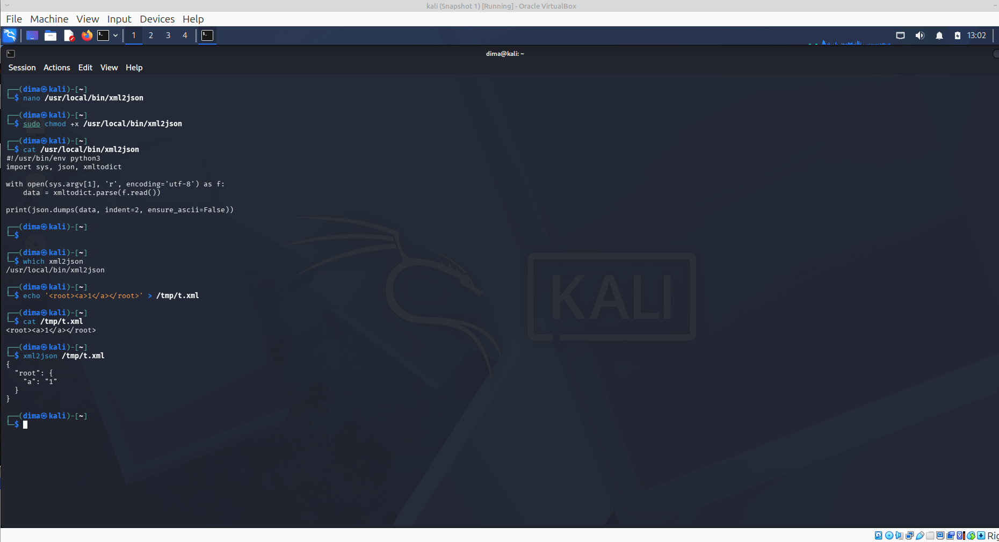
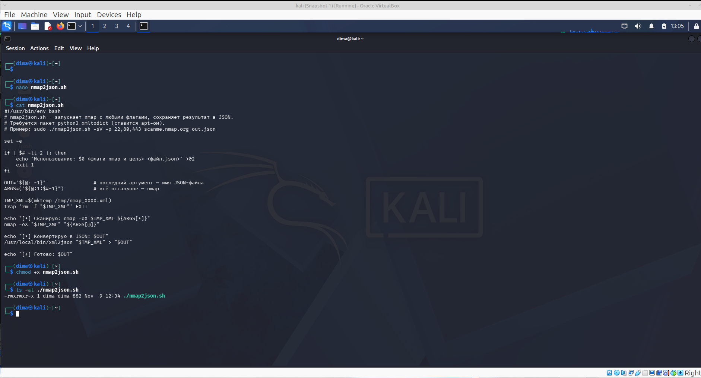
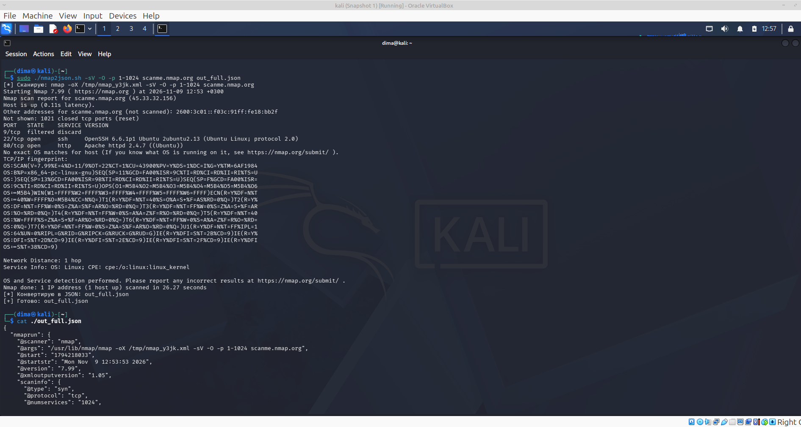

[На главную](../README.md)

---------
### Задание 4

**Нужно сделать такой скрипт или обертку nmap, чтобы передавались в него те же самые параметры, что и для nmap (детект сервисов, детект ОС, указание портов разными способами, передача целей для сканирования (из файла или в строке запуска)), чтобы результат сканирования выводился в файл в формате json**.  
**При этом в json отчете не должно быть лишних полей, то есть, если не передавался параметр для детектирования ОС, то ключа, связанного с ОС в json быть не должно, аналогично с детектом сервисов**. 
**Желательно на Python или Bash. Если очень хочется, то можно и на компилируемом языке, но тогда в репу кладите бинарь, который скомпилирован на ВМ в Kali.**.

---------

### Подготовка окружения. xml2json конвертер.
```bash
                                                                                                                                                                                                                                            
┌──(dima㉿kali)-[~]
└─$ nano /usr/local/bin/xml2json
                                                                                                                                                                                                                                            
┌──(dima㉿kali)-[~]
└─$ sudo chmod +x /usr/local/bin/xml2json
                                                                                                                                                                                                                                            
┌──(dima㉿kali)-[~]
└─$ cat /usr/local/bin/xml2json   
#!/usr/bin/env python3
import sys, json, xmltodict

with open(sys.argv[1], 'r', encoding='utf-8') as f:
    data = xmltodict.parse(f.read())

print(json.dumps(data, indent=2, ensure_ascii=False))
                                                                                                                                                                                                                                            
┌──(dima㉿kali)-[~]
└─$ 
                                                                                                                                                                                                                                            
┌──(dima㉿kali)-[~]
└─$ which xml2json
/usr/local/bin/xml2json
                                                                                                                                                                                                                                            
┌──(dima㉿kali)-[~]
└─$ echo '<root><a>1</a></root>' > /tmp/t.xml
                                                                                                                                                                                                                                            
┌──(dima㉿kali)-[~]
└─$ cat /tmp/t.xml             
<root><a>1</a></root>
                                                                                                                                                                                                                                            
┌──(dima㉿kali)-[~]
└─$ xml2json /tmp/t.xml
{
  "root": {
    "a": "1"
  }
}
                                                                                                                                                                                                                                            
┌──(dima㉿kali)-[~]
└─$ 


```


### Скрипт nmap2json.sh

```bash
┌──(dima㉿kali)-[~]
└─$ nano nmap2json.sh  
                                                                                                                                                                                                                                            
┌──(dima㉿kali)-[~]
└─$ cat nmap2json.sh 
#!/usr/bin/env bash
# nmap2json.sh — запускает nmap с любыми флагами, сохраняет результат в JSON.
# Требуется пакет python3-xmltodict (ставится apt-ом).
# Пример: sudo ./nmap2json.sh -sV -p 22,80,443 scanme.nmap.org out.json

set -e

if [ $# -lt 2 ]; then
    echo "Использование: $0 <флаги nmap и цель> <файл.json>" >&2
    exit 1
fi

OUT="${@: -1}"                # последний аргумент — имя JSON-файла
ARGS=("${@:1:$#-1}")          # всё остальное — nmap

TMP_XML=$(mktemp /tmp/nmap_XXXX.xml)
trap 'rm -f "$TMP_XML"' EXIT

echo "[*] Сканирую: nmap -oX $TMP_XML ${ARGS[*]}"
nmap -oX "$TMP_XML" "${ARGS[@]}"

echo "[*] Конвертирую в JSON: $OUT"
/usr/local/bin/xml2json "$TMP_XML" > "$OUT"

echo "[+] Готово: $OUT"
                                                                                                                                                                                                                                            
┌──(dima㉿kali)-[~]
└─$ chmod +x nmap2json.sh 
                                                                                                                                                                                                                                            
┌──(dima㉿kali)-[~]
└─$ ls -al ./nmap2json.sh 
-rwxrwxr-x 1 dima dima 882 Nov  9 12:34 ./nmap2json.sh
                                                                                                                                                                                                                                            
┌──(dima㉿kali)-[~]
└─$                                         
```


### Демонстрации

### 1) только порты

```bash
                                                                                                                                                                                                                                            
┌──(dima㉿kali)-[~]
└─$ sudo ./nmap2json.sh -p 22,80,443 scanme.nmap.org out_ports_only.json
[*] Сканирую: nmap -oX /tmp/nmap_crVv.xml -p 22,80,443 scanme.nmap.org
Starting Nmap 7.99 ( https://nmap.org ) at 2026-11-09 12:38 +0300
Nmap scan report for scanme.nmap.org (45.33.32.156)
Host is up (0.059s latency).
Other addresses for scanme.nmap.org (not scanned): 2600:3c01::f03c:91ff:fe18:bb2f

PORT    STATE  SERVICE
22/tcp  open   ssh
80/tcp  open   http
443/tcp closed https

Nmap done: 1 IP address (1 host up) scanned in 4.45 seconds
[*] Конвертирую в JSON: out_ports_only.json
[+] Готово: out_ports_only.json
                                                                                                                                                                                                                                            
┌──(dima㉿kali)-[~]
└─$ 

┌──(dima㉿kali)-[~]
└─$ cat ./out_ports_only.json  
{
  "nmaprun": {
    "@scanner": "nmap",
    "@args": "/usr/lib/nmap/nmap -oX /tmp/nmap_crVv.xml -p 22,80,443 scanme.nmap.org",
    "@start": "1794217108",
    "@startstr": "Mon Nov  9 12:38:28 2026",
    "@version": "7.99",
    "@xmloutputversion": "1.05",
    "scaninfo": {
      "@type": "syn",
      "@protocol": "tcp",
      "@numservices": "3",
      "@services": "22,80,443"
    },
    "verbose": {
      "@level": "0"
    },
    "debugging": {
      "@level": "0"
    },
    "hosthint": {
      "status": {
        "@state": "up",
        "@reason": "unknown-response",
        "@reason_ttl": "0"
      },
      "address": {
        "@addr": "45.33.32.156",
        "@addrtype": "ipv4"
      },
      "hostnames": {
        "hostname": {
          "@name": "scanme.nmap.org",
          "@type": "user"
        }
      }
    },
    "host": {
      "@starttime": "1794217113",
      "@endtime": "1794217113",
      "status": {
        "@state": "up",
        "@reason": "reset",
        "@reason_ttl": "255"
      },
      "address": {
        "@addr": "45.33.32.156",
        "@addrtype": "ipv4"
      },
      "hostnames": {
        "hostname": [
          {
            "@name": "scanme.nmap.org",
            "@type": "user"
          },
          {
            "@name": "scanme.nmap.org",
            "@type": "PTR"
          }
        ]
      },
      "ports": {
        "port": [
          {
            "@protocol": "tcp",
            "@portid": "22",
            "state": {
              "@state": "open",
              "@reason": "syn-ack",
              "@reason_ttl": "64"
            },
            "service": {
              "@name": "ssh",
              "@method": "table",
              "@conf": "3"
            }
          },
          {
            "@protocol": "tcp",
            "@portid": "80",
            "state": {
              "@state": "open",
              "@reason": "syn-ack",
              "@reason_ttl": "64"
            },
            "service": {
              "@name": "http",
              "@method": "table",
              "@conf": "3"
            }
          },
          {
            "@protocol": "tcp",
            "@portid": "443",
            "state": {
              "@state": "closed",
              "@reason": "reset",
              "@reason_ttl": "64"
            },
            "service": {
              "@name": "https",
              "@method": "table",
              "@conf": "3"
            }
          }
        ]
      },
      "times": {
        "@srtt": "59278",
        "@rttvar": "90918",
        "@to": "422950"
      }
    },
    "runstats": {
      "finished": {
        "@time": "1794217113",
        "@timestr": "Mon Nov  9 12:38:33 2026",
        "@summary": "Nmap done at Mon Nov  9 12:38:33 2026; 1 IP address (1 host up) scanned in 4.45 seconds",
        "@elapsed": "4.45",
        "@exit": "success"
      },
      "hosts": {
        "@up": "1",
        "@down": "0",
        "@total": "1"
      }
    }
  }
}
                                                                                                                                                                                                                                            
┌──(dima㉿kali)-[~]
└─$ 
```


### 2) с -sV

```bash

                                                                                                                                                                                                                                            
┌──(dima㉿kali)-[~]
└─$ sudo ./nmap2json.sh -sV -p 22,80 scanme.nmap.org out_sv.json
[*] Сканирую: nmap -oX /tmp/nmap_iHAt.xml -sV -p 22,80 scanme.nmap.org
Starting Nmap 7.99 ( https://nmap.org ) at 2026-11-09 12:44 +0300
Nmap scan report for scanme.nmap.org (45.33.32.156)
Host is up (0.044s latency).
Other addresses for scanme.nmap.org (not scanned): 2600:3c01::f03c:91ff:fe18:bb2f

PORT   STATE SERVICE VERSION
22/tcp open  ssh     OpenSSH 6.6.1p1 Ubuntu 2ubuntu2.13 (Ubuntu Linux; protocol 2.0)
80/tcp open  http    Apache httpd 2.4.7 ((Ubuntu))
Service Info: OS: Linux; CPE: cpe:/o:linux:linux_kernel

Service detection performed. Please report any incorrect results at https://nmap.org/submit/ .
Nmap done: 1 IP address (1 host up) scanned in 12.85 seconds
[*] Конвертирую в JSON: out_sv.json
[+] Готово: out_sv.json
                                                                                                                                                                                                                                            
┌──(dima㉿kali)-[~]
└─$ 

┌──(dima㉿kali)-[~]
└─$ cat ./out_sv.json        
{
  "nmaprun": {
    "@scanner": "nmap",
    "@args": "/usr/lib/nmap/nmap -oX /tmp/nmap_iHAt.xml -sV -p 22,80 scanme.nmap.org",
    "@start": "1794217481",
    "@startstr": "Mon Nov  9 12:44:41 2026",
    "@version": "7.99",
    "@xmloutputversion": "1.05",
    "scaninfo": {
      "@type": "syn",
      "@protocol": "tcp",
      "@numservices": "2",
      "@services": "22,80"
    },
    "verbose": {
      "@level": "0"
    },
    "debugging": {
      "@level": "0"
    },
    "hosthint": {
      "status": {
        "@state": "up",
        "@reason": "unknown-response",
        "@reason_ttl": "0"
      },
      "address": {
        "@addr": "45.33.32.156",
        "@addrtype": "ipv4"
      },
      "hostnames": {
        "hostname": {
          "@name": "scanme.nmap.org",
          "@type": "user"
        }
      }
    },
    "host": {
      "@starttime": "1794217485",
      "@endtime": "1794217493",
      "status": {
        "@state": "up",
        "@reason": "reset",
        "@reason_ttl": "255"
      },
      "address": {
        "@addr": "45.33.32.156",
        "@addrtype": "ipv4"
      },
      "hostnames": {
        "hostname": [
          {
            "@name": "scanme.nmap.org",
            "@type": "user"
          },
          {
            "@name": "scanme.nmap.org",
            "@type": "PTR"
          }
        ]
      },
      "ports": {
        "port": [
          {
            "@protocol": "tcp",
            "@portid": "22",
            "state": {
              "@state": "open",
              "@reason": "syn-ack",
              "@reason_ttl": "64"
            },
            "service": {
              "@name": "ssh",
              "@product": "OpenSSH",
              "@version": "6.6.1p1 Ubuntu 2ubuntu2.13",
              "@extrainfo": "Ubuntu Linux; protocol 2.0",
              "@ostype": "Linux",
              "@method": "probed",
              "@conf": "10",
              "cpe": [
                "cpe:/a:openbsd:openssh:6.6.1p1",
                "cpe:/o:linux:linux_kernel"
              ]
            }
          },
          {
            "@protocol": "tcp",
            "@portid": "80",
            "state": {
              "@state": "open",
              "@reason": "syn-ack",
              "@reason_ttl": "64"
            },
            "service": {
              "@name": "http",
              "@product": "Apache httpd",
              "@version": "2.4.7",
              "@extrainfo": "(Ubuntu)",
              "@method": "probed",
              "@conf": "10",
              "cpe": "cpe:/a:apache:http_server:2.4.7"
            }
          }
        ]
      },
      "times": {
        "@srtt": "43617",
        "@rttvar": "76381",
        "@to": "349141"
      }
    },
    "runstats": {
      "finished": {
        "@time": "1794217493",
        "@timestr": "Mon Nov  9 12:44:53 2026",
        "@summary": "Nmap done at Mon Nov  9 12:44:53 2026; 1 IP address (1 host up) scanned in 12.85 seconds",
        "@elapsed": "12.85",
        "@exit": "success"
      },
      "hosts": {
        "@up": "1",
        "@down": "0",
        "@total": "1"
      }
    }
  }
}
                                                                                                                                                                                                                                            
┌──(dima㉿kali)-[~]
└─$ 

```

### 3) с -O

```bash
┌──(dima㉿kali)-[~]
└─$ ping 212.34.148.220                       
PING 212.34.148.220 (212.34.148.220) 56(84) bytes of data.
64 bytes from 212.34.148.220: icmp_seq=1 ttl=64 time=54.8 ms
64 bytes from 212.34.148.220: icmp_seq=2 ttl=64 time=55.6 ms
64 bytes from 212.34.148.220: icmp_seq=3 ttl=64 time=54.6 ms
^C
--- 212.34.148.220 ping statistics ---
3 packets transmitted, 3 received, 0% packet loss, time 2013ms
rtt min/avg/max/mdev = 54.575/55.002/55.597/0.433 ms
                                                                                                                                                                                                                                            
┌──(dima㉿kali)-[~]
└─$ sudo ./nmap2json.sh -O -p 22,80 212.34.148.220 out_os.json
[*] Сканирую: nmap -oX /tmp/nmap_AKoB.xml -O -p 22,80 212.34.148.220
Starting Nmap 7.99 ( https://nmap.org ) at 2026-11-09 12:49 +0300
Nmap scan report for v914225.hosted-by-vdsina.com (212.34.148.220)
Host is up (0.028s latency).

PORT   STATE  SERVICE
22/tcp open   ssh
80/tcp closed http
Device type: VoIP adapter|bridge|general purpose
Running (JUST GUESSING): AT&T embedded (91%), Oracle Virtualbox (89%), Slirp (89%), QEMU (86%)
OS CPE: cpe:/a:oracle:vm_virtualbox cpe:/a:danny_gasparovski:slirp cpe:/a:qemu:qemu
Aggressive OS guesses: AT&T BGW210 voice gateway (91%), Oracle Virtualbox Slirp NAT bridge (89%), QEMU user mode network gateway (86%)
No exact OS matches for host (test conditions non-ideal).
Network Distance: 1 hop

OS detection performed. Please report any incorrect results at https://nmap.org/submit/ .
Nmap done: 1 IP address (1 host up) scanned in 8.71 seconds
[*] Конвертирую в JSON: out_os.json
[+] Готово: out_os.json
                                                                                                                                                                                                                                            
┌──(dima㉿kali)-[~]
└─$ cat ./out_os.json 
{
  "nmaprun": {
    "@scanner": "nmap",
    "@args": "/usr/lib/nmap/nmap -oX /tmp/nmap_AKoB.xml -O -p 22,80 212.34.148.220",
    "@start": "1794217781",
    "@startstr": "Mon Nov  9 12:49:41 2026",
    "@version": "7.99",
    "@xmloutputversion": "1.05",
    "scaninfo": {
      "@type": "syn",
      "@protocol": "tcp",
      "@numservices": "2",
      "@services": "22,80"
    },
    "verbose": {
      "@level": "0"
    },
    "debugging": {
      "@level": "0"
    },
    "hosthint": {
      "status": {
        "@state": "up",
        "@reason": "unknown-response",
        "@reason_ttl": "0"
      },
      "address": {
        "@addr": "212.34.148.220",
        "@addrtype": "ipv4"
      },
      "hostnames": null
    },
    "host": {
      "@starttime": "1794217784",
      "@endtime": "1794217790",
      "status": {
        "@state": "up",
        "@reason": "reset",
        "@reason_ttl": "255"
      },
      "address": {
        "@addr": "212.34.148.220",
        "@addrtype": "ipv4"
      },
      "hostnames": {
        "hostname": {
          "@name": "v914225.hosted-by-vdsina.com",
          "@type": "PTR"
        }
      },
      "ports": {
        "port": [
          {
            "@protocol": "tcp",
            "@portid": "22",
            "state": {
              "@state": "open",
              "@reason": "syn-ack",
              "@reason_ttl": "64"
            },
            "service": {
              "@name": "ssh",
              "@method": "table",
              "@conf": "3"
            }
          },
          {
            "@protocol": "tcp",
            "@portid": "80",
            "state": {
              "@state": "closed",
              "@reason": "reset",
              "@reason_ttl": "64"
            },
            "service": {
              "@name": "http",
              "@method": "table",
              "@conf": "3"
            }
          }
        ]
      },
      "os": {
        "portused": [
          {
            "@state": "open",
            "@proto": "tcp",
            "@portid": "22"
          },
          {
            "@state": "closed",
            "@proto": "tcp",
            "@portid": "80"
          },
          {
            "@state": "closed",
            "@proto": "udp",
            "@portid": "44367"
          }
        ],
        "osmatch": [
          {
            "@name": "AT&T BGW210 voice gateway",
            "@accuracy": "91",
            "@line": "10195",
            "osclass": {
              "@type": "VoIP adapter",
              "@vendor": "AT&T",
              "@osfamily": "embedded",
              "@accuracy": "91"
            }
          },
          {
            "@name": "Oracle Virtualbox Slirp NAT bridge",
            "@accuracy": "89",
            "@line": "100002",
            "osclass": [
              {
                "@type": "bridge",
                "@vendor": "Oracle",
                "@osfamily": "Virtualbox",
                "@accuracy": "89",
                "cpe": "cpe:/a:oracle:vm_virtualbox"
              },
              {
                "@type": "bridge",
                "@vendor": "Slirp",
                "@osfamily": "Slirp",
                "@accuracy": "89",
                "cpe": "cpe:/a:danny_gasparovski:slirp"
              }
            ]
          },
          {
            "@name": "QEMU user mode network gateway",
            "@accuracy": "86",
            "@line": "101823",
            "osclass": {
              "@type": "general purpose",
              "@vendor": "QEMU",
              "@osfamily": "QEMU",
              "@accuracy": "86",
              "cpe": "cpe:/a:qemu:qemu"
            }
          }
        ]
      },
      "distance": {
        "@value": "1"
      },
      "tcpsequence": {
        "@index": "21",
        "@difficulty": "Good luck!",
        "@values": "26B14601,26B24001,26B43401,26B52E01,26B62801,26B72201"
      },
      "ipidsequence": {
        "@class": "Randomized",
        "@values": "6830,40A0,175C,934E,2AF1,70CD"
      },
      "tcptssequence": {
        "@class": "none returned (unsupported)"
      },
      "times": {
        "@srtt": "28294",
        "@rttvar": "29413",
        "@to": "145946"
      }
    },
    "runstats": {
      "finished": {
        "@time": "1794217790",
        "@timestr": "Mon Nov  9 12:49:50 2026",
        "@summary": "Nmap done at Mon Nov  9 12:49:50 2026; 1 IP address (1 host up) scanned in 8.71 seconds",
        "@elapsed": "8.71",
        "@exit": "success"
      },
      "hosts": {
        "@up": "1",
        "@down": "0",
        "@total": "1"
      }
    }
  }
}
                                                                                                                                                                                                                                            
┌──(dima㉿kali)-[~]
└─$ 

```
### 4) с -sV -O

```bash
┌──(dima㉿kali)-[~]
└─$ sudo ./nmap2json.sh -sV -O -p 1-1024 scanme.nmap.org out_full.json
[*] Сканирую: nmap -oX /tmp/nmap_y3jk.xml -sV -O -p 1-1024 scanme.nmap.org
Starting Nmap 7.99 ( https://nmap.org ) at 2026-11-09 12:53 +0300
Nmap scan report for scanme.nmap.org (45.33.32.156)
Host is up (0.11s latency).
Other addresses for scanme.nmap.org (not scanned): 2600:3c01::f03c:91ff:fe18:bb2f
Not shown: 1021 closed tcp ports (reset)
PORT   STATE    SERVICE VERSION
9/tcp  filtered discard
22/tcp open     ssh     OpenSSH 6.6.1p1 Ubuntu 2ubuntu2.13 (Ubuntu Linux; protocol 2.0)
80/tcp open     http    Apache httpd 2.4.7 ((Ubuntu))
No exact OS matches for host (If you know what OS is running on it, see https://nmap.org/submit/ ).
TCP/IP fingerprint:
OS:SCAN(V=7.99%E=4%D=11/9%OT=22%CT=1%CU=43900%PV=Y%DS=1%DC=I%G=Y%TM=6AF1984
OS:B%P=x86_64-pc-linux-gnu)SEQ(SP=11%GCD=FA00%ISR=9C%TI=RD%CI=RD%II=RI%TS=U
OS:)SEQ(SP=13%GCD=FA00%ISR=9B%TI=RD%CI=RD%II=RI%TS=U)SEQ(SP=F%GCD=FA00%ISR=
OS:9C%TI=RD%CI=RD%II=RI%TS=U)OPS(O1=M5B4%O2=M5B4%O3=M5B4%O4=M5B4%O5=M5B4%O6
OS:=M5B4)WIN(W1=FFFF%W2=FFFF%W3=FFFF%W4=FFFF%W5=FFFF%W6=FFFF)ECN(R=Y%DF=N%T
OS:=40%W=FFFF%O=M5B4%CC=N%Q=)T1(R=Y%DF=N%T=40%S=O%A=S+%F=AS%RD=0%Q=)T2(R=Y%
OS:DF=N%T=FF%W=0%S=Z%A=S%F=AR%O=%RD=0%Q=)T3(R=Y%DF=N%T=FF%W=0%S=Z%A=S+%F=AR
OS:%O=%RD=0%Q=)T4(R=Y%DF=N%T=FF%W=0%S=A%A=Z%F=R%O=%RD=0%Q=)T5(R=Y%DF=N%T=40
OS:%W=FFFF%S=Z%A=S+%F=AR%O=%RD=0%Q=)T6(R=Y%DF=N%T=FF%W=0%S=A%A=Z%F=R%O=%RD=
OS:0%Q=)T7(R=Y%DF=N%T=FF%W=0%S=Z%A=S%F=AR%O=%RD=0%Q=)U1(R=Y%DF=N%T=FF%IPL=1
OS:64%UN=0%RIPL=G%RID=G%RIPCK=G%RUCK=G%RUD=G)IE(R=Y%DFI=S%T=2B%CD=9)IE(R=Y%
OS:DFI=S%T=2D%CD=9)IE(R=Y%DFI=S%T=2E%CD=9)IE(R=Y%DFI=S%T=2F%CD=9)IE(R=Y%DFI
OS:=S%T=38%CD=9)

Network Distance: 1 hop
Service Info: OS: Linux; CPE: cpe:/o:linux:linux_kernel

OS and Service detection performed. Please report any incorrect results at https://nmap.org/submit/ .
Nmap done: 1 IP address (1 host up) scanned in 26.27 seconds
[*] Конвертирую в JSON: out_full.json
[+] Готово: out_full.json
                                                                                                                                                                                                                                            
┌──(dima㉿kali)-[~]
└─$ cat ./out_full.json 
{
  "nmaprun": {
    "@scanner": "nmap",
    "@args": "/usr/lib/nmap/nmap -oX /tmp/nmap_y3jk.xml -sV -O -p 1-1024 scanme.nmap.org",
    "@start": "1794218033",
    "@startstr": "Mon Nov  9 12:53:53 2026",
    "@version": "7.99",
    "@xmloutputversion": "1.05",
    "scaninfo": {
      "@type": "syn",
      "@protocol": "tcp",
      "@numservices": "1024",
      "@services": "1-1024"
    },
    "verbose": {
      "@level": "0"
    },
    "debugging": {
      "@level": "0"
    },
    "hosthint": {
      "status": {
        "@state": "up",
        "@reason": "unknown-response",
        "@reason_ttl": "0"
      },
      "address": {
        "@addr": "45.33.32.156",
        "@addrtype": "ipv4"
      },
      "hostnames": {
        "hostname": {
          "@name": "scanme.nmap.org",
          "@type": "user"
        }
      }
    },
    "host": {
      "@starttime": "1794218037",
      "@endtime": "1794218059",
      "status": {
        "@state": "up",
        "@reason": "reset",
        "@reason_ttl": "255"
      },
      "address": {
        "@addr": "45.33.32.156",
        "@addrtype": "ipv4"
      },
      "hostnames": {
        "hostname": [
          {
            "@name": "scanme.nmap.org",
            "@type": "user"
          },
          {
            "@name": "scanme.nmap.org",
            "@type": "PTR"
          }
        ]
      },
      "ports": {
        "extraports": {
          "@state": "closed",
          "@count": "1021",
          "extrareasons": {
            "@reason": "reset",
            "@count": "1021",
            "@proto": "tcp",
            "@ports": "1-8,10-21,23-79,81-1024"
          }
        },
        "port": [
          {
            "@protocol": "tcp",
            "@portid": "9",
            "state": {
              "@state": "filtered",
              "@reason": "no-response",
              "@reason_ttl": "0"
            },
            "service": {
              "@name": "discard",
              "@method": "table",
              "@conf": "3"
            }
          },
          {
            "@protocol": "tcp",
            "@portid": "22",
            "state": {
              "@state": "open",
              "@reason": "syn-ack",
              "@reason_ttl": "64"
            },
            "service": {
              "@name": "ssh",
              "@product": "OpenSSH",
              "@version": "6.6.1p1 Ubuntu 2ubuntu2.13",
              "@extrainfo": "Ubuntu Linux; protocol 2.0",
              "@ostype": "Linux",
              "@method": "probed",
              "@conf": "10",
              "cpe": [
                "cpe:/a:openbsd:openssh:6.6.1p1",
                "cpe:/o:linux:linux_kernel"
              ]
            }
          },
          {
            "@protocol": "tcp",
            "@portid": "80",
            "state": {
              "@state": "open",
              "@reason": "syn-ack",
              "@reason_ttl": "64"
            },
            "service": {
              "@name": "http",
              "@product": "Apache httpd",
              "@version": "2.4.7",
              "@extrainfo": "(Ubuntu)",
              "@method": "probed",
              "@conf": "10",
              "cpe": "cpe:/a:apache:http_server:2.4.7"
            }
          }
        ]
      },
      "os": {
        "portused": [
          {
            "@state": "open",
            "@proto": "tcp",
            "@portid": "22"
          },
          {
            "@state": "closed",
            "@proto": "tcp",
            "@portid": "1"
          },
          {
            "@state": "closed",
            "@proto": "udp",
            "@portid": "43900"
          }
        ],
        "osmatch": [
          {
            "@name": "AT&T BGW210 voice gateway",
            "@accuracy": "91",
            "@line": "10195",
            "osclass": {
              "@type": "VoIP adapter",
              "@vendor": "AT&T",
              "@osfamily": "embedded",
              "@accuracy": "91"
            }
          },
          {
            "@name": "Oracle Virtualbox Slirp NAT bridge",
            "@accuracy": "89",
            "@line": "100002",
            "osclass": [
              {
                "@type": "bridge",
                "@vendor": "Oracle",
                "@osfamily": "Virtualbox",
                "@accuracy": "89",
                "cpe": "cpe:/a:oracle:vm_virtualbox"
              },
              {
                "@type": "bridge",
                "@vendor": "Slirp",
                "@osfamily": "Slirp",
                "@accuracy": "89",
                "cpe": "cpe:/a:danny_gasparovski:slirp"
              }
            ]
          },
          {
            "@name": "QEMU user mode network gateway",
            "@accuracy": "88",
            "@line": "101823",
            "osclass": {
              "@type": "general purpose",
              "@vendor": "QEMU",
              "@osfamily": "QEMU",
              "@accuracy": "88",
              "cpe": "cpe:/a:qemu:qemu"
            }
          }
        ],
        "osfingerprint": {
          "@fingerprint": "OS:SCAN(V=7.99%E=4%D=11/9%OT=22%CT=1%CU=43900%PV=Y%DS=1%DC=I%G=Y%TM=6AF1984\nOS:B%P=x86_64-pc-linux-gnu)SEQ(SP=11%GCD=FA00%ISR=9C%TI=RD%CI=RD%II=RI%TS=U\nOS:)SEQ(SP=13%GCD=FA00%ISR=9B%TI=RD%CI=RD%II=RI%TS=U)SEQ(SP=F%GCD=FA00%ISR=\nOS:9C%TI=RD%CI=RD%II=RI%TS=U)OPS(O1=M5B4%O2=M5B4%O3=M5B4%O4=M5B4%O5=M5B4%O6\nOS:=M5B4)WIN(W1=FFFF%W2=FFFF%W3=FFFF%W4=FFFF%W5=FFFF%W6=FFFF)ECN(R=Y%DF=N%T\nOS:=40%W=FFFF%O=M5B4%CC=N%Q=)T1(R=Y%DF=N%T=40%S=O%A=S+%F=AS%RD=0%Q=)T2(R=Y%\nOS:DF=N%T=FF%W=0%S=Z%A=S%F=AR%O=%RD=0%Q=)T3(R=Y%DF=N%T=FF%W=0%S=Z%A=S+%F=AR\nOS:%O=%RD=0%Q=)T4(R=Y%DF=N%T=FF%W=0%S=A%A=Z%F=R%O=%RD=0%Q=)T5(R=Y%DF=N%T=40\nOS:%W=FFFF%S=Z%A=S+%F=AR%O=%RD=0%Q=)T6(R=Y%DF=N%T=FF%W=0%S=A%A=Z%F=R%O=%RD=\nOS:0%Q=)T7(R=Y%DF=N%T=FF%W=0%S=Z%A=S%F=AR%O=%RD=0%Q=)U1(R=Y%DF=N%T=FF%IPL=1\nOS:64%UN=0%RIPL=G%RID=G%RIPCK=G%RUCK=G%RUD=G)IE(R=Y%DFI=S%T=2B%CD=9)IE(R=Y%\nOS:DFI=S%T=2D%CD=9)IE(R=Y%DFI=S%T=2E%CD=9)IE(R=Y%DFI=S%T=2F%CD=9)IE(R=Y%DFI\nOS:=S%T=38%CD=9)\n"
        }
      },
      "distance": {
        "@value": "1"
      },
      "tcpsequence": {
        "@index": "19",
        "@difficulty": "Good luck!",
        "@values": "28D71401,28D80E01,28D90801,28DAFC01,28DBF601,28DCF001"
      },
      "ipidsequence": {
        "@class": "Randomized",
        "@values": "9415,4D26,3B2E,53CE,B095,73AA"
      },
      "tcptssequence": {
        "@class": "none returned (unsupported)"
      },
      "times": {
        "@srtt": "109112",
        "@rttvar": "89322",
        "@to": "466400"
      }
    },
    "runstats": {
      "finished": {
        "@time": "1794218059",
        "@timestr": "Mon Nov  9 12:54:19 2026",
        "@summary": "Nmap done at Mon Nov  9 12:54:19 2026; 1 IP address (1 host up) scanned in 26.27 seconds",
        "@elapsed": "26.27",
        "@exit": "success"
      },
      "hosts": {
        "@up": "1",
        "@down": "0",
        "@total": "1"
      }
    }
  }
}
                                                                                                                                                                                                                                            
┌──(dima㉿kali)-[~]
└─$ 


```


### Скриншоты

### Подготовка окружения. xml2json конвертер.




### Скрипт nmap2json.sh




### Демонстрации




[На главную](../README.md)
